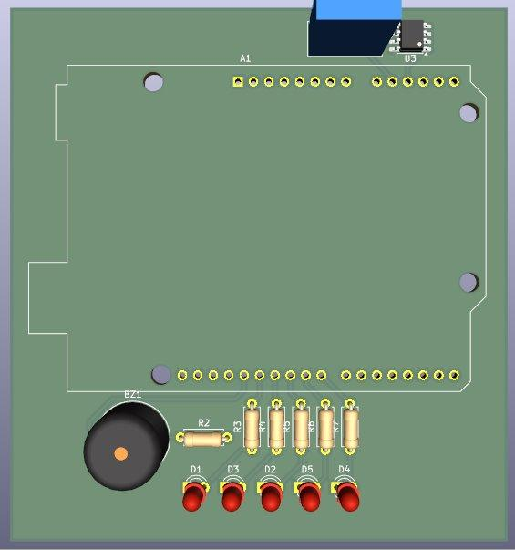
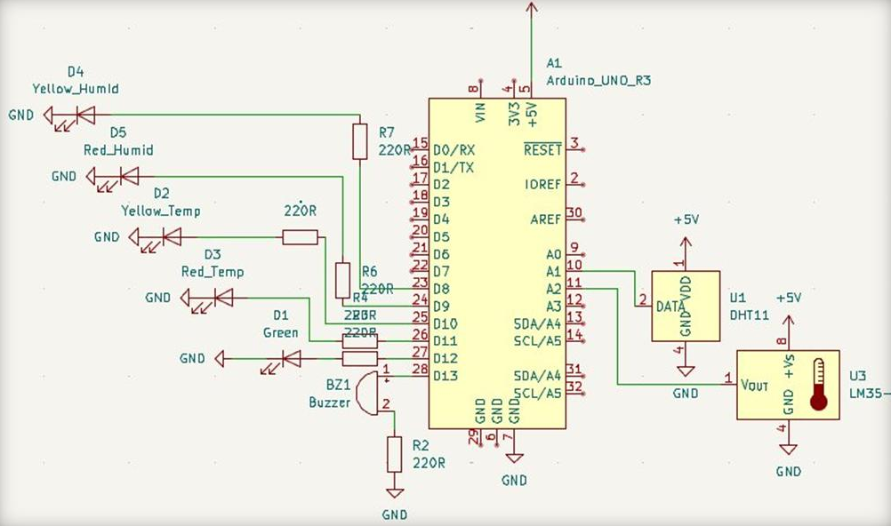
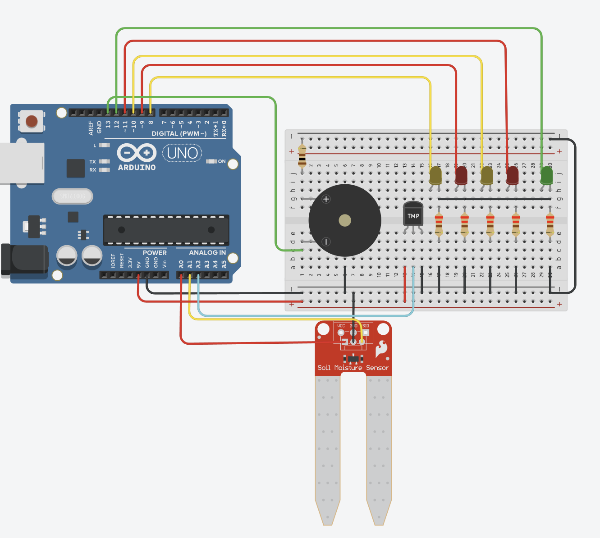
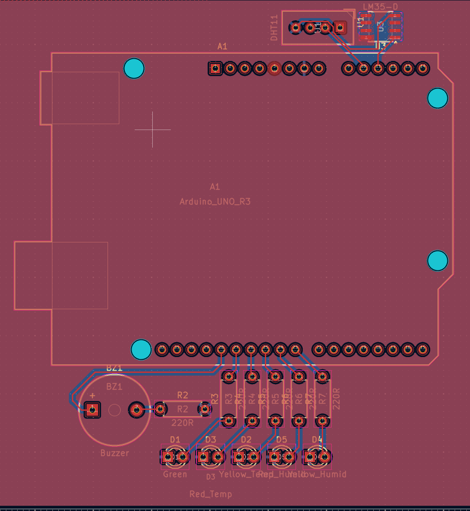

# ServerGuard

An environmental monitoring shield for the Arduino Uno. It watches temperature and humidity and gives a visual and audible warning when conditions drift out of range. It's built for spaces like server rooms, where heat and moisture damage equipment.

I designed the schematic and the 2-layer PCB in KiCad 9.

## Features

- **Two sensors:** a DHT11 reads temperature and humidity, and an LM35 analog sensor gives a second temperature reading.
- **Status LEDs:** a green LED for normal conditions, plus separate yellow (warning) and red (alert) LEDs for temperature and for humidity.
- **Buzzer:** sounds an audible alarm.
- **Shield form factor:** the board stacks directly on an Arduino Uno R3, using the Uno's mounting holes. It takes power from the Uno's 5V rail.

## Hardware

| Ref | Part | Purpose |
|-----|------|---------|
| A1 | Arduino Uno R3 | Microcontroller (the shield mounts on it) |
| U1 | DHT11 | Temperature and humidity sensor |
| U3 | LM35 (SOIC-8) | Analog temperature sensor |
| D1 | Green LED | System normal |
| D2 / D3 | Yellow / red LED | Temperature warning / alert |
| D4 / D5 | Yellow / red LED | Humidity warning / alert |
| BZ1 | Buzzer (12 mm) | Audible alarm |
| R2–R7 | 220 Ω resistors | Current limiting for the LEDs and buzzer |

### Pin map

| Arduino pin | Connected to |
|-------------|--------------|
| A1 | DHT11 data |
| A2 | LM35 output |
| D8 | Yellow LED (humidity) |
| D9 | Red LED (humidity) |
| D10 | Yellow LED (temperature) |
| D11 | Red LED (temperature) |
| D12 | Green LED (normal) |
| D13 | Buzzer |
| 5V / GND | Sensor power |

## Schematic

## Prototype

Before designing the PCB, the team built and simulated the circuit in Tinkercad. Tinkercad has no DHT11, so the prototype used a TMP36 for temperature and a soil moisture sensor as the humidity input.

### Firmware

I wrote the prototype firmware: [`prototype/serverguard_tinkercad/serverguard_tinkercad.ino`](prototype/serverguard_tinkercad/serverguard_tinkercad.ino). In a continuous loop, it:

1. Reads the temperature and moisture sensors and prints both to the serial monitor (9600 baud).
2. Compares the readings against server-room style thresholds:

   | Reading | Warning (yellow LED) | Alarm (red LED + buzzer) |
   |---------|----------------------|--------------------------|
   | Temperature | 27 °C | 30 °C |
   | Moisture (raw ADC) | 350 | 500 |

3. Lights the green LED only when both readings are normal, and beeps the buzzer twice whenever either reading reaches its alarm level.

The LED and buzzer pins match the PCB. To run on the PCB's sensors, the firmware needs two changes: read the DHT11 with a DHT library, and convert the LM35 with `voltage × 100` instead of the TMP36's `(voltage − 0.5) × 100`.

## PCB

- 2 layers, about 82 × 88 mm
- +5V copper pour on the top layer and a GND pour on the bottom layer
- Through-hole LEDs, resistors and buzzer for easy hand assembly. The LM35 is surface-mount (SOIC-8).

## Repository contents

| File | Contents |
|------|----------|
| `ECCSEgroup7.kicad_pro` | KiCad project file |
| `ECCSEgroup7.kicad_sch` | Schematic |
| `ECCSEgroup7.kicad_pcb` | PCB layout |
| `prototype/serverguard_tinkercad/` | Arduino firmware from the Tinkercad prototype |
| `images/` | 3D render, schematic, PCB layout and Tinkercad prototype |

To view the design, open `ECCSEgroup7.kicad_pro` in KiCad 9 or later.

## My role

This was a four-person team project for a college engineering course. I led the team, designed the schematic and PCB layout, wrote the Arduino firmware and authored most of the presentation and the final report. My teammates came up with the initial concept and helped with brainstorming, Tinkercad prototyping and the presentation.
